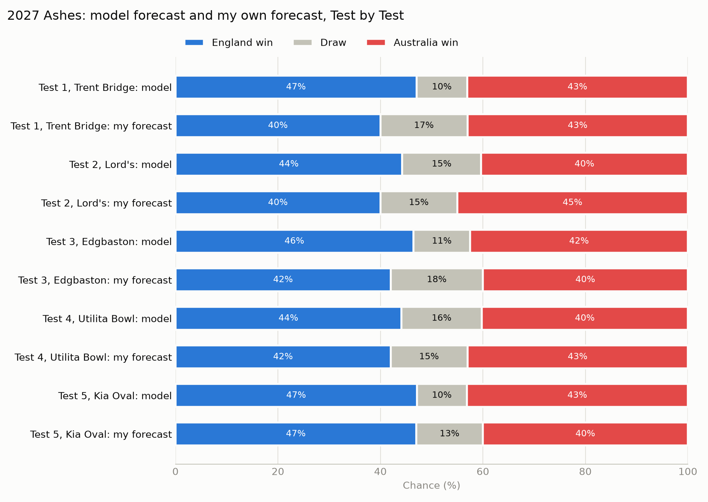
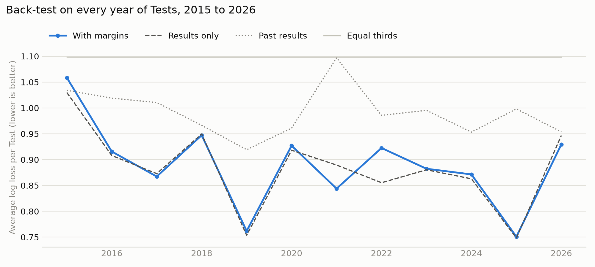
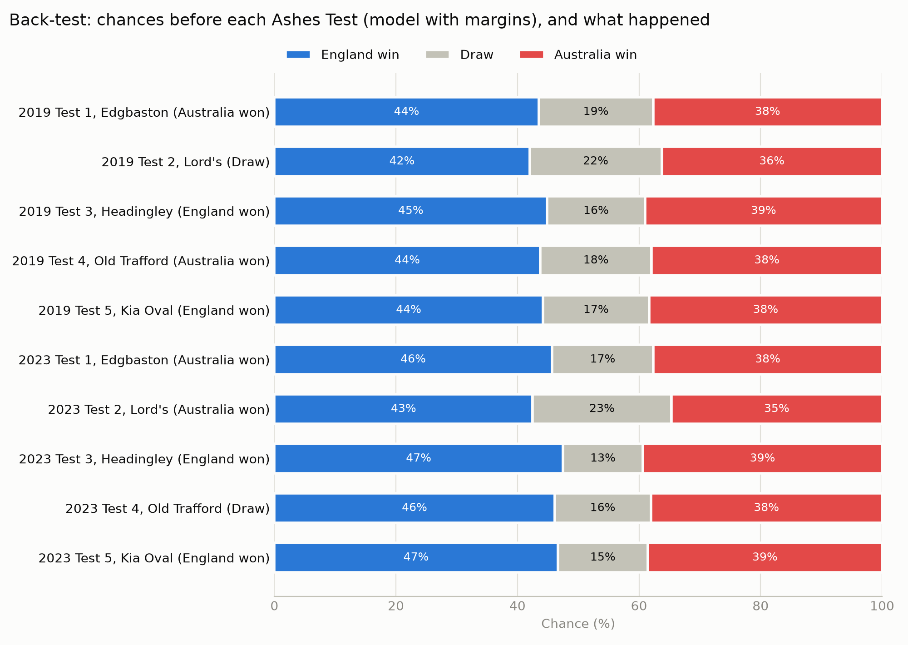
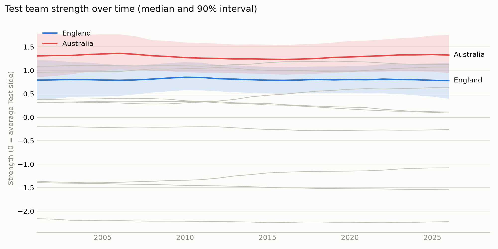
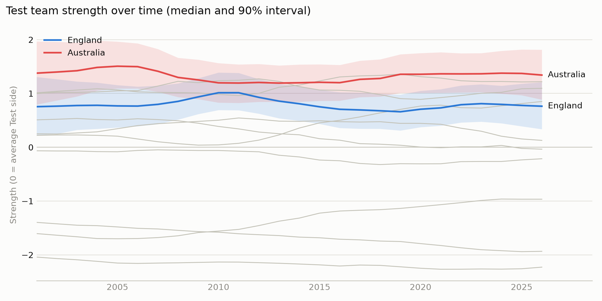
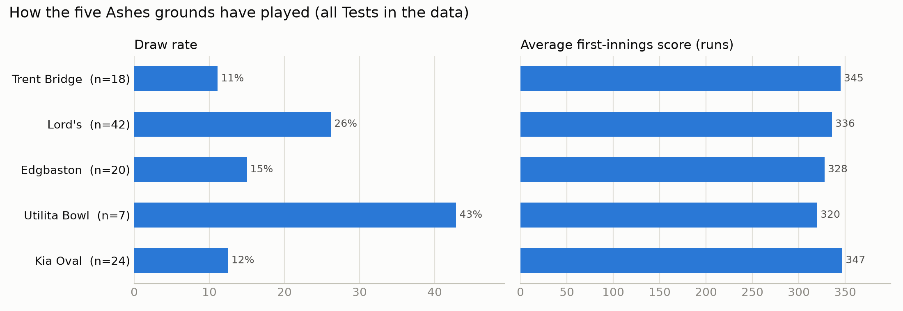
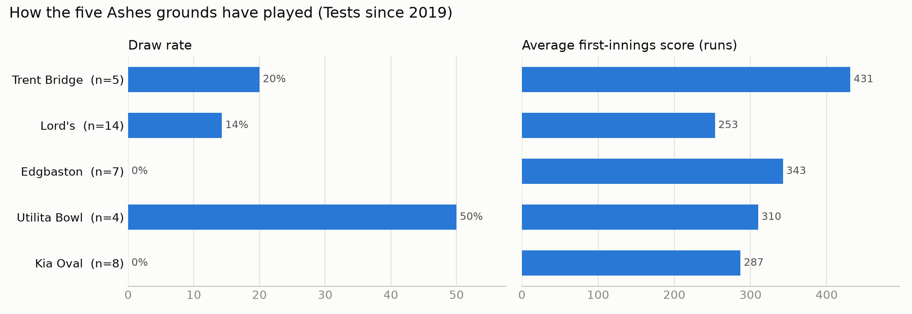
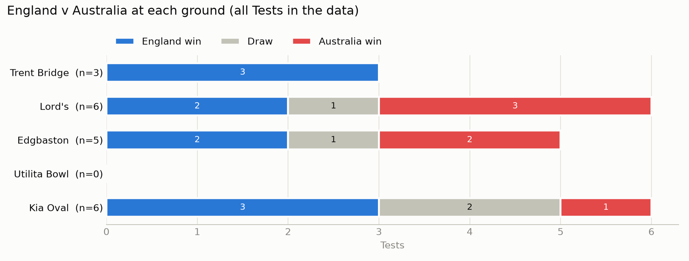

# Forecasting the 2027 Ashes

A Bayesian forecast of the 2027 men's Ashes: England v Australia, five Tests in England from 18 June to 2 August 2027.
For each Test the model gives the chance of an England win, a draw and an Australia win, and carries its uncertainty
through to every series result.

## Headline forecast



| Test | Ground | Dates | England win | Draw | Australia win |
| --- | --- | --- | --- | --- | --- |
| 1 | Trent Bridge | 18–22 June | 47% | 10% | 43% |
| 2 | Lord's | 30 June–4 July | 44% | 15% | 40% |
| 3 | Edgbaston | 8–12 July | 46% | 11% | 42% |
| 4 | Utilita Bowl | 21–25 July | 44% | 16% | 40% |
| 5 | Kia Oval | 29 July–2 August | 47% | 10% | 43% |

| Series | England win | Drawn series | Australia win | Australia retain the urn |
| --- | --- | --- | --- | --- |
| Model | 47% | 13% | 40% | 53% |
| Model, if the Tests were independent | 47% | 14% | 39% | 53% |
| My own forecast, written before any modelling | 42% | 16% | 42% | 58% |

England are slight favourites at home because the model's home advantage (0.63) is a little larger than the gap
between the teams (Australia 1.33, England 0.78 on the model's scale).

## The question and the approach

1. **Read every men's Test** in Cricsheet since 2001, ball by ball, into tested tables of matches, innings, deliveries
   and appearances.
2. **Check the data independently.** Every recorded winning margin must match the totals rebuilt from individual
   deliveries. It holds for all 729 wins with a recorded margin.
3. **Profile the five grounds** from their history: draw rates, first-innings scores, overs bowled, the toss and how
   batters were dismissed.
4. **Fit a Bayesian model** in PyMC with Hamiltonian Monte Carlo (NUTS).
5. **Back-test it** on every year of Tests from 2015 to 2026 and on the 2019 and 2023 Ashes, always using only earlier
   Tests, with and without winning margins.
6. **Forecast each 2027 Test and the series**, and compare with a forecast written down before any modelling.

## The model

Each Test is an ordered outcome: team A loses, draws or wins. The strength gap plus home advantage sits on one line,
and a band of width $w$ in the middle is a draw.

$$\eta = s_{A,t} - s_{B,t} + h \cdot \text{home}$$

$$P(\text{A loses}) = \sigma\left(-\tfrac{w}{2} - \eta\right), \qquad P(\text{A wins}) = 1 - \sigma\left(\tfrac{w}{2} - \eta\right)$$

$$\log w = \beta_0 + v_{\text{venue}} + \tau \cdot \frac{\text{year} - 2019}{10}$$

| Part | Choice |
| --- | --- |
| Team strength $s_{T,t}$ | A yearly random walk for each of 11 teams, centred each year so 0 is an average Test side |
| Home advantage $h$ | One value for all teams. The home side is inferred from the data: the team playing at least 80% of the Tests at a place |
| Draw band | A base width, a trend per decade since 2019, and a venue effect for each of 103 venues, partially pooled |
| Parameterisation | Non-centred, for the random walk and the venue effects |
| Data | 898 Tests from 2001 to 2026 (the one-off ICC World XI Test is excluded) |

**A version I tested and did not adopt: winning margins.** For every win, the size of the win $m$ in wickets also
depends on the winner's edge, through a normal distribution cut off at 0:

$$\log(1 + m) \sim \text{Normal}^{+}\left(\mu_0 + \lambda \cdot \eta_{\text{winner}},\ \sigma_m\right)$$

Runs are converted at the average of 32.6 runs per wicket, and an innings win adds 10 wickets. It is still available
with `--results-only` left off. See "How good is it?" for why the forecast does not use it.

## Does the fit work?

| Check | Result | Target |
| --- | --- | --- |
| Worst R-hat | 1.002 | below 1.01 |
| Smallest effective sample size | 718 | above 400 |
| Divergences | 0 | 0 |

Four chains of 1,000 warm-up and 1,000 kept draws, with a target acceptance of 0.95. R-hat and effective sample size are
implemented from first principles in [`diagnostics.py`](src/cricket/diagnostics.py) and tested against cases with known
answers. Full results are in [`figures/sampler_checks.csv`](figures/sampler_checks.csv).

## How good is it?

Every back-test fits the model only on Tests played before the ones it forecasts.

**Every year of Tests, 2015 to 2026:** 472 Tests in all countries, each year forecast from the Tests before it.

| Average per Test (lower is better) | Results only | With margins | Past results | Equal thirds |
| --- | --- | --- | --- | --- |
| Log loss | 0.884 | 0.890 | 0.994 | 1.099 |
| Brier score | 0.520 | 0.524 | 0.597 | 0.667 |

The results-only model beat the past-results forecast on log loss in all 12 years. Adding winning margins was better
in 4 years and worse in 8, and slightly worse overall: no reliable gain.



**The 2019 and 2023 Ashes:** 10 Tests.

| Average per Test (lower is better) | Results only | With margins | Past results | Equal thirds |
| --- | --- | --- | --- | --- |
| Log loss | 1.061 | 1.048 | 1.097 | 1.099 |
| Brier score | 0.647 | 0.637 | 0.670 | 0.667 |

On these ten Tests margins looked better, but the 472-Test back-test does not confirm it. Ten Tests is too few, so the
forecast uses the results-only model: the simpler of two versions that perform the same.



## What the model learned

| Parameter | Mean | 90% interval |
| --- | --- | --- |
| Home advantage | 0.63 | 0.51 to 0.75 |
| Draw trend per decade | −0.52 | −0.71 to −0.34 |
| Australia strength, 2026 | 1.33 | 0.94 to 1.76 |
| England strength, 2026 | 0.78 | 0.40 to 1.16 |

- **Draws are becoming much rarer.** The draw band narrows by about 40% per decade. At the five grounds, 20% of Tests
  were drawn overall but 13% since 2019.
- **Grounds differ beyond their weather.** Lord's draws more than any other well-sampled ground despite London being
  one of the drier fixtures; Trent Bridge, the wettest, draws among the least.
- **Partial pooling at work.** The Utilita Bowl has a raw draw rate of 43% from only seven Tests. The model rates it
  about the same as Lord's, with a 90% interval about 40% wider.
- **Strengths are heavily smoothed.** Seeing only win, draw or loss, the model allows little change from year to year,
  so the strength chart is almost flat.
- **Margins make strengths move, but do not improve forecasts.** With margins, stronger winners clearly win by more
  (slope 0.17, 0.14 to 0.21), and England's peak around 2010–11 and Australia's dip around 2010–13 both show. The
  back-test shows this extra movement does not predict the next year's Tests any better.





## How each ground plays







## Limitations

- **Little information per Test.** The forecast model sees only win, draw or loss. Winning margins were tested and did
  not improve forecasts, so the yearly strengths stay heavily smoothed.
- **Teams, not players.** Squads, injuries and workloads between back-to-back Tests are collected and validated in
  `data/manual/` but not yet used by the model.
- **One home advantage for every team.**
- **No historical match weather.** Each ground's effect already includes its typical summer weather. The Met Office
  climate averages in `data/manual/` explain those effects and can adjust a forecast in the week of each Test.

## Next steps

1. Build player-level strengths from the expected XIs, with availability per Test and a cover plan for replacements.
2. Use ball-by-ball runs and wickets, such as first-innings leads, to give each Test more information than its result.
3. Let home advantage differ by team.

Each change is kept only if it improves the yearly back-test.

## Reproduce it

Requires [uv](https://docs.astral.sh/uv/).

```bash
uv sync
uv run pytest                                      # 173 tests
```

Download the **Test matches (JSON)** and the **People register** from [Cricsheet](https://cricsheet.org/downloads/).
Unzip the matches into `data/raw/tests_json/` and save `people.csv` in `data/raw/`. Then:

```bash
uv run python -m cricket.ingest                    # build the tables
uv run python -m cricket.checks                    # independent check on the totals
uv run python -m cricket.manual_data               # validate squads, availability, fixtures and weather
uv run python -m cricket.cover_plan                # validate the replacement plan
uv run python -m cricket.grounds                   # ground profiles and charts
uv run python -m cricket.grounds --since 2019-01-01
uv run python -m cricket.rolling_backtest          # back-test on every year, 2015 to 2026
uv run python -m cricket.backtest --tune 2000 --draws 2000   # back-test on the 2019 and 2023 Ashes
uv run python -m cricket.forecast --results-only   # fit the model and forecast 2027
```

## Project layout

| Path | Contents |
| --- | --- |
| `src/cricket/ingest.py` | Reads Cricsheet Test files into four tables |
| `src/cricket/checks.py` | Independent check of innings totals against recorded margins |
| `src/cricket/manual_data.py`, `cover_plan.py` | Validation of squads, availability, fixtures, venues, weather and the cover plan |
| `src/cricket/find_ids.py`, `fill_ids.py` | Helpers for matching players to Cricsheet IDs |
| `src/cricket/grounds.py`, `charts.py` | Ground profiles and charts |
| `src/cricket/model_data.py` | Prepares the model inputs, including the home side and winning margins |
| `src/cricket/bayes_model.py` | The PyMC model, with winning margins as an option |
| `src/cricket/diagnostics.py` | R-hat and effective sample size |
| `src/cricket/predict.py` | Test and series forecasts from posterior draws |
| `src/cricket/rolling_backtest.py` | Forecasts every year of Tests from the years before, and scores both versions |
| `src/cricket/backtest.py` | Forecasts the 2019 and 2023 Ashes using only earlier Tests, and scores both versions |
| `src/cricket/forecast.py` | Fits the model and produces the forecast |
| `data/manual/` | Squads, availability, cover plan, fixtures, venues, climate and my own forecast |
| `figures/` | Charts and results tables |
| `tests/` | 173 tests |
| [`DECISIONS.md`](DECISIONS.md) | Every modelling and data decision, with reasons |

## Data sources

- Ball-by-ball match data: [Cricsheet](https://cricsheet.org)
- 2027 schedule: [ECB](https://www.ecb.co.uk/news/4539854/three-ashes-series-headline-england-cricket-home-international-fixtures-for-2027)
- Climate averages, 1991–2020: [Met Office](https://www.metoffice.gov.uk/research/climate/maps-and-data/location-specific-long-term-averages)