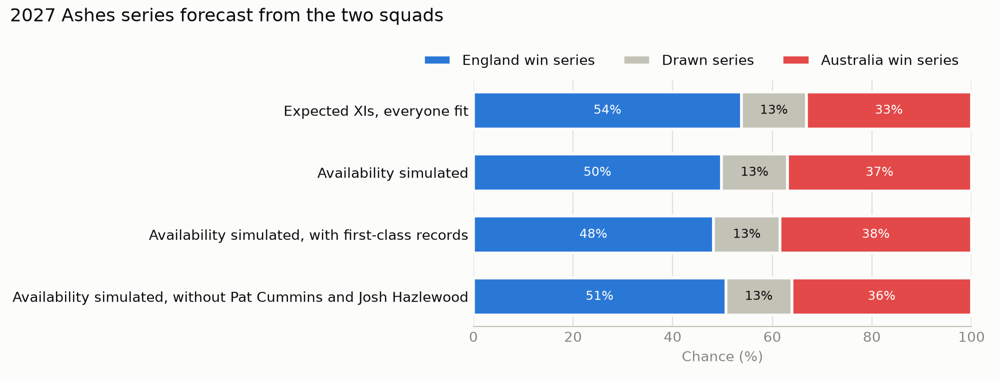

# Forecasting the 2027 Ashes

A Bayesian forecast of the 2027 men's Ashes: England v Australia, five Tests in England from 18 June to 2 August 2027.
For each Test the model gives the chance of an England win, a draw and an Australia win, and carries its uncertainty
through to every series result.

## Headline forecast


| Test | Ground | Dates | England win | Draw | Australia win |
| --- | --- | --- | --- | --- | --- |
| 1 | Trent Bridge | 18–22 June | 47% | 10% | 43% |
| 2 | Lord's | 30 June–4 July | 44% | 15% | 40% |
| 3 | Edgbaston | 8–12 July | 46% | 11% | 42% |
| 4 | Utilita Bowl | 21–25 July | 44% | 16% | 40% |
| 5 | Kia Oval | 29 July–2 August | 47% | 10% | 43% |

| Series | England win | Drawn series | Australia win | Australia retain the urn |
| --- | --- | --- | --- | --- |
| Model | 47% | 13% | 40% | 53% |
| Model, if the Tests were independent | 47% | 14% | 39% | 53% |
| My own forecast, written before any modelling | 42% | 16% | 42% | 58% |

England are slight favourites at home because the model's home advantage (0.63) is a little larger than the gap
between the teams (Australia 1.33, England 0.78 on the model's scale).

Building the forecast from the two squads, with each player's chance of being fit for each Test, gives England 49%,
a drawn series 13% and Australia 37%. See "Players, squads and availability".

## The question and the approach

1. **Read every men's Test** in Cricsheet since 2001, ball by ball, into tested tables of matches, innings, deliveries
   and appearances.
2. **Check the data independently.** Every recorded winning margin must match the totals rebuilt from individual
   deliveries. It holds for all 729 wins with a recorded margin.
3. **Profile the five grounds** from their history: draw rates, first-innings scores, overs bowled, the toss and how
   batters were dismissed.
4. **Fit a Bayesian model** in PyMC with Hamiltonian Monte Carlo (NUTS).
5. **Rate every player and every XI** from ball-by-ball records, using only Tests played before each match.
6. **Back-test it** on every year of Tests from 2015 to 2026 and on the 2019 and 2023 Ashes, always using only earlier
   Tests, with and without winning margins and XI ratings.
7. **Forecast each 2027 Test and the series**, and compare with a forecast written down before any modelling.
8. **Simulate the series from the two squads**, with availability per Test and a cover plan for replacements.

## The model

Each Test is an ordered outcome: team A loses, draws or wins. The strength gap plus home advantage sits on one line,
and a band of width $w$ in the middle is a draw.

$$\eta = s_{A,t} - s_{B,t} + h \cdot \text{home}$$

$$P(\text{A loses}) = \sigma\left(-\tfrac{w}{2} - \eta\right), \qquad P(\text{A wins}) = 1 - \sigma\left(\tfrac{w}{2} - \eta\right)$$

$$\log w = \beta_0 + v_{\text{venue}} + \tau \cdot \frac{\text{year} - 2019}{10}$$

| Part | Choice |
| --- | --- |
| Team strength $s_{T,t}$ | A yearly random walk for each of 11 teams, centred each year so 0 is an average Test side |
| Home advantage $h$ | One value for all teams. The home side is inferred from the data: the team playing at least 80% of the Tests at a place |
| Draw band | A base width, a trend per decade since 2019, and a venue effect for each of 103 venues, partially pooled |
| Parameterisation | Non-centred, for the random walk and the venue effects |
| Data | 898 Tests from 2001 to 2026 (the one-off ICC World XI Test is excluded) |

**A version I tested and did not adopt: winning margins.** For every win, the size of the win $m$ in wickets also
depends on the winner's edge, through a normal distribution cut off at 0:

$$\log(1 + m) \sim \text{Normal}^{+}\left(\mu_0 + \lambda \cdot \eta_{\text{winner}},\ \sigma_m\right)$$

Runs are converted at the average of 32.6 runs per wicket, and an innings win adds 10 wickets. It is still available
with `--results-only` left off. See "How good is it?" for why the forecast does not use it.

**A version I tested and kept for what-if questions: XI ratings.** The strength of each side's XI on the day is added
on top of team strength, per 10 runs of batting average and of bowling average:

$$\eta = s_{A,t} - s_{B,t} + h \cdot \text{home} + \beta_{\text{bat}} \cdot \frac{\text{bat}_A - \text{bat}_B}{10} + \beta_{\text{bowl}} \cdot \frac{\text{bowl}_B - \text{bowl}_A}{10}$$

The bowling gap is turned round because a lower bowling average is better. Tests before 2004 have no XI ratings and
count as two even XIs. It forecasts as well as results only, so it is used for the squad forecast and not the
headline.

## Does the fit work?

| Check | Result | Target |
| --- | --- | --- |
| Worst R-hat | 1.002 | below 1.01 |
| Smallest effective sample size | 718 | above 400 |
| Divergences | 0 | 0 |

Four chains of 1,000 warm-up and 1,000 kept draws, with a target acceptance of 0.95. R-hat and effective sample size are
implemented from first principles in [`diagnostics.py`](src/cricket/diagnostics.py) and tested against cases with known
answers. Full results are in [`figures/sampler_checks.csv`](figures/sampler_checks.csv).

## How good is it?

Every back-test fits the model only on Tests played before the ones it forecasts.

**Every year of Tests, 2015 to 2026:** 472 Tests in all countries, each year forecast from the Tests before it.

| Average per Test (lower is better) | Results only | With margins | With XI ratings | Past results | Equal thirds |
| --- | --- | --- | --- | --- | --- |
| Log loss | 0.883 | 0.890 | 0.883 | 0.994 | 1.099 |
| Brier score | 0.519 | 0.524 | 0.520 | 0.597 | 0.667 |

The results-only model beat the past-results forecast on log loss in all 12 years. Adding winning margins was better
in 4 years and worse in 8, and slightly worse overall: no reliable gain. Adding XI ratings was better in 7 years and
worse in 5, including each of the last four, and level overall. The chart shows results only against XI ratings.


**The 2019 and 2023 Ashes:** 10 Tests.

| Average per Test (lower is better) | Results only | With margins | Past results | Equal thirds |
| --- | --- | --- | --- | --- |
| Log loss | 1.061 | 1.048 | 1.097 | 1.099 |
| Brier score | 0.647 | 0.637 | 0.670 | 0.667 |

On these ten Tests margins looked better, but the 472-Test back-test does not confirm it. Ten Tests is too few, so the
forecast uses the results-only model: the simpler of two versions that perform the same.


## What the model learned

| Parameter | Mean | 90% interval |
| --- | --- | --- |
| Home advantage | 0.63 | 0.51 to 0.75 |
| Draw trend per decade | −0.52 | −0.71 to −0.34 |
| Australia strength, 2026 | 1.33 | 0.94 to 1.76 |
| England strength, 2026 | 0.78 | 0.40 to 1.16 |

- **Draws are becoming much rarer.** The draw band narrows by about 40% per decade. At the five grounds, 20% of Tests
  were drawn overall but 13% since 2019.
- **Grounds differ beyond their weather.** Lord's draws more than any other well-sampled ground despite London being
  one of the drier fixtures; Trent Bridge, the wettest, draws among the least.
- **Partial pooling at work.** The Utilita Bowl has a raw draw rate of 43% from only seven Tests. The model rates it
  about the same as Lord's, with a 90% interval about 40% wider.
- **Strengths are heavily smoothed.** Seeing only win, draw or loss, the model allows little change from year to year,
  so the strength chart is almost flat.
- **Margins make strengths move, but do not improve forecasts.** With margins, stronger winners clearly win by more
  (slope 0.17, 0.14 to 0.21), and England's peak around 2010–11 and Australia's dip around 2010–13 both show. The
  back-test shows this extra movement does not predict the next year's Tests any better.
- **The bowling attack matters beyond team strength; the batting line-up does not.** Each 10 runs of bowling average
  is worth 0.39 (0.03 to 0.76). Each 10 runs of batting average is worth 0.06 (−0.36 to 0.49).


## Players, squads and availability

**Rating players.** Batting is runs per dismissal and bowling is runs conceded per wicket, from ball-by-ball data.
Byes and leg byes are not charged to the bowler and run-outs are not credited to him. Each Test is weighted by how
recent it is, with a half-life of two years. Every player is pulled towards the average for his type, as if he had 10
extra dismissals or wickets at that average: 34.8 runs per dismissal for the top seven, and 14.5 for the lower order.

**First-class records.** Players with fewer than 10 Tests can instead start from their first-class record. Batting uses
85% of the first-class average, and each record is pulled towards the average in proportion to its size, so 18 wickets
count for far less than 370. This cannot be back-tested, so the forecast is shown with and without it.

**Rating each XI.** Batting is the average of all eleven. Bowling is the average of the five main bowlers: in past
Tests, the five who bowled most balls in that match; in 2027, by role, with specialist bowlers first, then
allrounders. Stronger XIs win more often:

| XI gap, team A against team B | Weakest fifth | Middle fifth | Strongest fifth |
| --- | --- | --- | --- |
| Batting: team A won | 36% | 46% | 58% |
| Bowling: team A won | 26% | 47% | 65% |

The attack was first rated on the five with the most career Test balls. That left out replacement seamers with few
Tests and counted part-time bowlers instead, so it was changed before the results below.

**Simulating the series.** The series is played 4,000 times, each run paired with one posterior draw. In each Test,
every player is available with the chance I gave him for that Test. Half the time a player's fitness follows one draw
for the whole series, so a player who misses one Test is more likely to miss another. Anyone missing is replaced by the
first available player in the cover plan for his role.

| Squad forecast | England win | Drawn series | Australia win | Australia retain the urn |
| --- | --- | --- | --- | --- |
| Expected XIs, everyone fit | 53% | 13% | 34% | 47% |
| Availability simulated | 49% | 13% | 37% | 51% |
| Availability simulated, with first-class records | 48% | 13% | 39% | 52% |
| Availability simulated, without Cummins and Hazlewood | 50% | 13% | 37% | 50% |

- **England's fitness risk costs them about 4 points.** Mostly through Archer, who plays about three of the five Tests.
- **Australia's depth protects them.** Boland and Neser are rated about as highly as Cummins and Hazlewood, so losing
  both for the whole series costs Australia about one point.
- **First-class records cost England a point.** They rate Bethell's bowling well below his short Test record suggests.



## How each ground plays


## Limitations

- **Little information per Test.** The forecast model sees only win, draw or loss. Winning margins were tested and did
  not improve forecasts, so the yearly strengths stay heavily smoothed.
- **Players add little beyond team strength.** The XI version forecasts no better than results only, because team
  strength is learned from results that already reflect who played.
- **Availability and cover are my own judgement**, from injury and workload news up to November 2026.
- **The first-class adjustment cannot be back-tested**, so it is shown as an alternative, not the main forecast.
- **One home advantage for every team.**
- **No historical match weather.** Each ground's effect already includes its typical summer weather. The Met Office
  climate averages in `data/manual/` explain those effects and can adjust a forecast in the week of each Test.

## Next steps

1. Use ball-by-ball runs and wickets, such as first-innings leads, to give each Test more information than its result.
2. Let home advantage differ by team.
3. Test whether the bowling attack matters more in English conditions with the Dukes ball.
4. Update availability and the cover plan when the squads are named in 2027, and run the squad forecast again.

Each change to the model is kept only if it improves the yearly back-test.

## Reproduce it

Requires [uv](https://docs.astral.sh/uv/).

```bash
uv sync
uv run pytest                                      # 214 tests
```

Download the **Test matches (JSON)** and the **People register** from [Cricsheet](https://cricsheet.org/downloads/).
Unzip the matches into `data/raw/tests_json/` and save `people.csv` in `data/raw/`. Then:

```bash
uv run python -m cricket.ingest                    # build the tables
uv run python -m cricket.checks                    # independent check on the totals
uv run python -m cricket.manual_data               # validate squads, availability, fixtures and weather
uv run python -m cricket.cover_plan                # validate the replacement plan
uv run python -m cricket.grounds                   # ground profiles and charts
uv run python -m cricket.grounds --since 2019-01-01
uv run python -m cricket.players                   # rate every squad player
uv run python -m cricket.lineups                   # rate every XI since 2004
uv run python -m cricket.rolling_backtest          # back-test on every year, 2015 to 2026
uv run python -m cricket.backtest --tune 2000 --draws 2000   # back-test on the 2019 and 2023 Ashes
uv run python -m cricket.forecast --results-only   # fit the model and forecast 2027
uv run python -m cricket.squad_forecast --without "Pat Cummins,Josh Hazlewood"   # forecast from the squads
```

## Project layout

| Path | Contents |
| --- | --- |
| `src/cricket/ingest.py` | Reads Cricsheet Test files into four tables |
| `src/cricket/checks.py` | Independent check of innings totals against recorded margins |
| `src/cricket/manual_data.py`, `cover_plan.py` | Validation of squads, availability, fixtures, venues, weather and the cover plan |
| `src/cricket/find_ids.py`, `fill_ids.py` | Helpers for matching players to Cricsheet IDs |
| `src/cricket/grounds.py`, `charts.py` | Ground profiles and charts |
| `src/cricket/model_data.py` | Prepares the model inputs, including the home side, winning margins and XI gaps |
| `src/cricket/bayes_model.py` | The PyMC model, with winning margins and XI ratings as options |
| `src/cricket/diagnostics.py` | R-hat and effective sample size |
| `src/cricket/predict.py` | Test and series forecasts from posterior draws |
| `src/cricket/players.py` | Player ratings from ball-by-ball data, with first-class records for new players |
| `src/cricket/lineups.py` | Rates each side's XI in every Test since 2004 |
| `src/cricket/rolling_backtest.py` | Forecasts every year of Tests from the years before, and scores each version |
| `src/cricket/backtest.py` | Forecasts the 2019 and 2023 Ashes using only earlier Tests, and scores both versions |
| `src/cricket/forecast.py` | Fits the model and produces the forecast |
| `src/cricket/squad_forecast.py` | Simulates availability and replacements, and forecasts the series from the squads |
| `data/manual/` | Squads, availability, cover plan, first-class records, fixtures, venues, climate and my own forecast |
| `figures/` | Charts and results tables |
| `tests/` | 214 tests |
| [`DECISIONS.md`](DECISIONS.md) | Every modelling and data decision, with reasons |

## Data sources

- Ball-by-ball match data: [Cricsheet](https://cricsheet.org)
- 2027 schedule: [ECB](https://www.ecb.co.uk/news/4539854/three-ashes-series-headline-england-cricket-home-international-fixtures-for-2027)
- Climate averages, 1991–2020: [Met Office](https://www.metoffice.gov.uk/research/climate/maps-and-data/location-specific-long-term-averages)
- First-class career records: Wikipedia player pages, which quote ESPNcricinfo